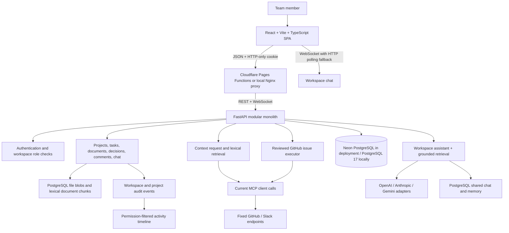

# SAHAKARYA Architecture

## Product direction

SAHAKARYA is a native collaboration ecosystem with one shared context and intelligence layer. Native projects, tasks, knowledge, decisions, activity, and workflows are the product foundation. MCP and APIs extend those capabilities to external systems such as GitHub and Slack. The current code is an early, working foundation rather than the complete ecosystem described by the master product prompt.

## Runtime architecture and free deployment

The browser does not call MCP servers and does not receive integration secrets. PostgreSQL is accessed through SQLAlchemy; Alembic migrations are the schema source of truth. Docker Compose provides the local PostgreSQL 17 service. The deployment guide uses one Render Free API, Neon Free for persistent data, and Cloudflare Pages for the static UI and same-origin API/WebSocket proxy; the public services have not yet been provisioned.

## Existing backend boundaries

- `app/api/`: health, auth, workspaces, projects, tasks, knowledge documents/uploads/search, decisions, activity, member administration, workspace chat, integrations, context requests, the grounded workspace assistant/memory APIs, and GitHub issue proposal/execution routes.
- `app/services/context_retrieval.py`: currently performs MCP tool discovery, safe read-tool filtering, result normalization, URL checking, lexical scoring inputs, and bounded context reads. Provider selection still imports integration configuration directly; a provider-neutral adapter layer remains future work.
- `app/services/reasoning.py`: provider-selectable OpenAI Responses, Anthropic Messages, and Gemini adapters share bounded context, strict structured output, citation validation, and unsupported-action rejection. Usage is persisted when returned. A separately injected adapter interface remains future work.
- `app/api/v1/assistant.py`: persists shared assistant turns, evidence assessments, and workspace/project memories; grounds answers and cited task drafts in bounded native and previously retrieved external records.
- `app/models/entities.py`: SQLAlchemy entities for users, sessions, workspaces/members/invitations, integrations, projects, tasks/comments, knowledge documents/files/chunks/versions/comments, decisions/history/references, chat channels/messages, assistant messages/memories, context records, requests, proposals/executions, and audit events.
- `app/core/`: environment settings, request ID context, and Fernet credential encryption.
- `frontend/src/App.tsx` is a hash-routed SPA shell and workspace selector. Native screens are split across ProjectTasks, KnowledgeHub, DecisionBoard, ActivityTimeline, WorkspaceMembers, ChatPanel, and WorkspaceSearch; integration and reviewed-action screens remain available.

There is no standalone `connectors/` package yet. GitHub/Slack connection logic currently lives in `app/api/v1/integrations.py`; retrieval and execution call the MCP client from their service/route modules.

## Target product layers

### Native applications

Shared workspaces contain projects and native tasks, knowledge documents, decisions, collaboration activity, and workflows. Each module reads and writes through workspace/project authorization. External services may enrich native records but are not required for native functionality.

### Central intelligence

A unified context interface will index native records and permitted external records with stable entity IDs, provenance, workspace/project scope, and relationships. Retrieval will combine lexical and semantic candidates, apply permission filters before ranking, enforce a configurable context/token budget, and preserve citations. LLM and embedding providers will be behind interfaces so the provider can change without rewriting domain services.

### External ecosystem

MCP and official API adapters expose a consistent capability description, connection lifecycle, health, tool schema, permissions, timeouts, and audit information. Every external write remains behind backend authorization, explicit human approval, payload validation, idempotency, and result reconciliation.

## Current data model and gaps

The current schema and API support workspace-scoped projects; tasks with assignment, labels, same-project acyclic dependencies, immutable history, comments, and notifications; persistent workspace chat with mentions; shared AI conversation, evidence assessments, and saved memories; uploaded PDF/DOCX/MD/TXT knowledge files; extracted document content; lexical search chunks; version snapshots/comments; and project decisions with owner/date/reasoning/alternatives/status/references/history. Files up to 5 MiB are stored in PostgreSQL; extracted text is capped at 100,000 characters. Chunks hold up to 300 words with 60-word overlap. Native search is lexical and returns attributed passages. Explicit grounded-answer and assistant requests may send bounded matched records to the selected configured reasoning provider; plain search stays local. Audit events carry an optional project ID, allowing the activity API/UI to filter project, task, document, decision and comment events. Workspace members can read; viewers are read-only for collaboration records and memory changes; owners manage member/viewer invitations and roles. Document edits are limited to the document owner or workspace owner. Project membership remains inherited from workspace membership. Invitation codes are hashed at rest and expire after seven days; delivery is manual because no mail provider is configured.

ContextEmbedding.embedding_json remains a generic JSON placeholder; pgvector and semantic search are not implemented. Uploaded scanned PDFs are rejected because OCR is not provided. Workspace chat uses in-process WebSocket fan-out with HTTP polling fallback; a multi-instance deployment needs a shared pub/sub layer. Remaining product gaps include project-scoped membership, document deletion/version restore, decision comments, safe workflows, workspace ownership transfer, rate limiting, and automated backups/monitoring.

New schemas should continue to use forward-only Alembic migrations, UUIDs, timestamps, foreign keys, and workspace/project filters. Workspace membership isolation is the baseline; project and native record authorization must extend, not bypass, those checks.

## Trust and safety rules

- Verify the user and workspace membership on every protected endpoint; add project-level checks as soon as projects gain members.
- Treat source text from external tools as untrusted data, never policy or tool instructions.
- Give the model typed proposals only. The model cannot choose permissions or execute arbitrary tools/database changes.
- Require explicit approval for consequential writes and bind approval to the exact canonical payload hash.
- Reconcile uncertain writes before retrying; never claim external success until the provider confirms it.
- Show a connector as verified only after a real provider handshake and capability discovery.
- Distinguish mocked/local test-server results from live external tests.

## Integration and operations status

GitHub connection uses `https://api.githubcopilot.com/mcp/`. The code accepts a PAT and discovers tools; tests use a local MCP server. The source repository push has been verified, but the app's live GitHub MCP reads and issue writes still need a scoped integration token. Slack uses `https://mcp.slack.com/mcp` with registered-app OAuth; tests cover the mocked flow, while live activation needs a Slack app, scopes, and the public HTTPS callback. OpenAI, Anthropic, and Gemini synthesis are optional and mock-tested; the latest live model request reached the configured provider but was rejected for usage quota.

Docker Desktop must be running before `docker compose up -d db`. If Docker is stopped, the API process may not start in prior workflows or requests will fail at database access; `/health/live` and `/health/ready` distinguish process liveness from PostgreSQL readiness. The API and UI were brought up and health-checked during the 2026-11-26 audit.

